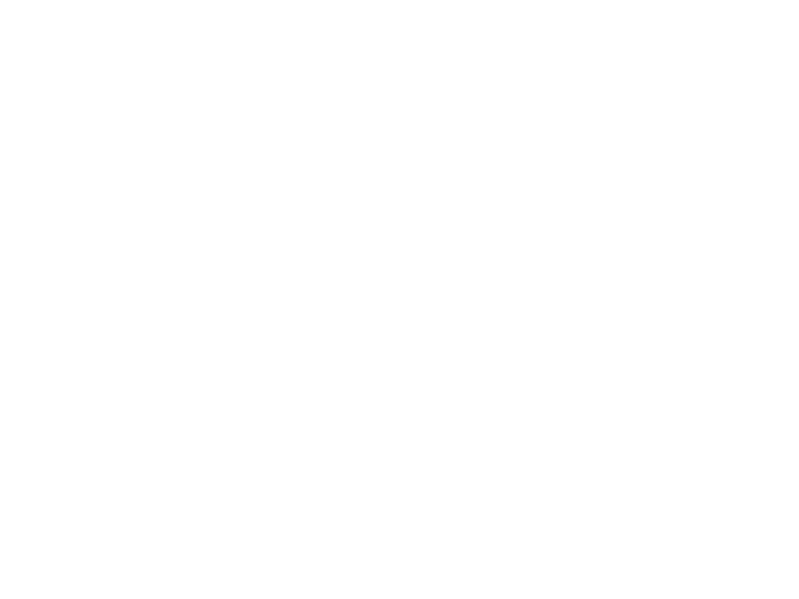
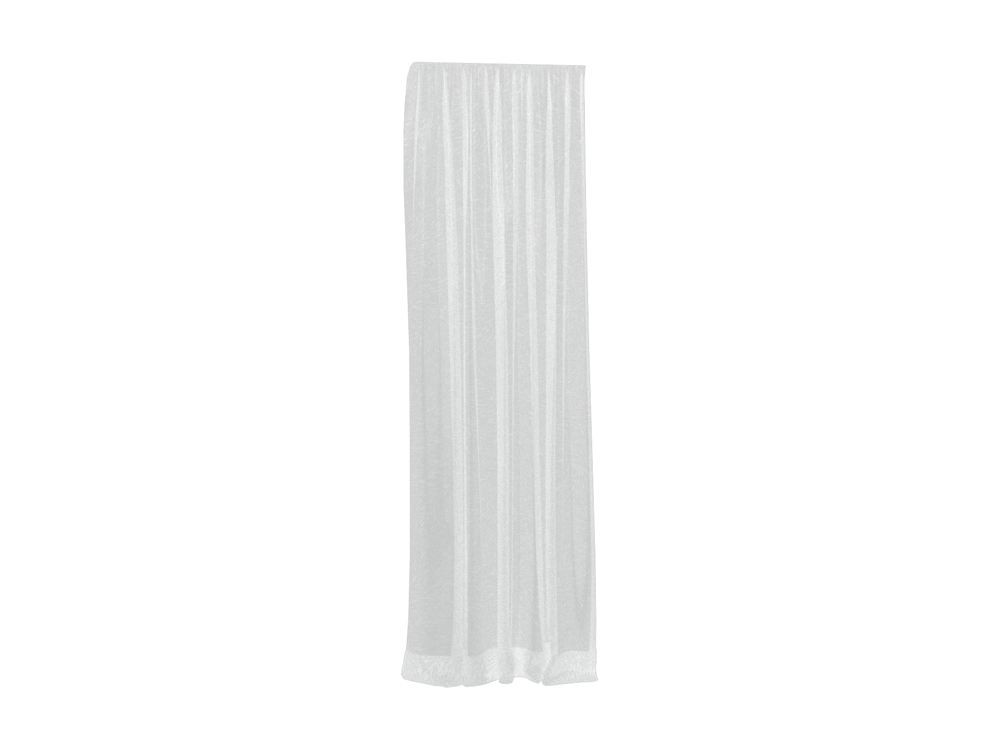
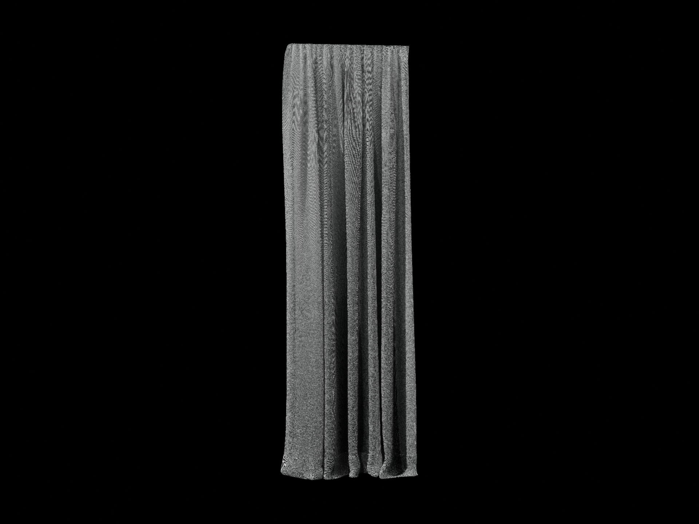
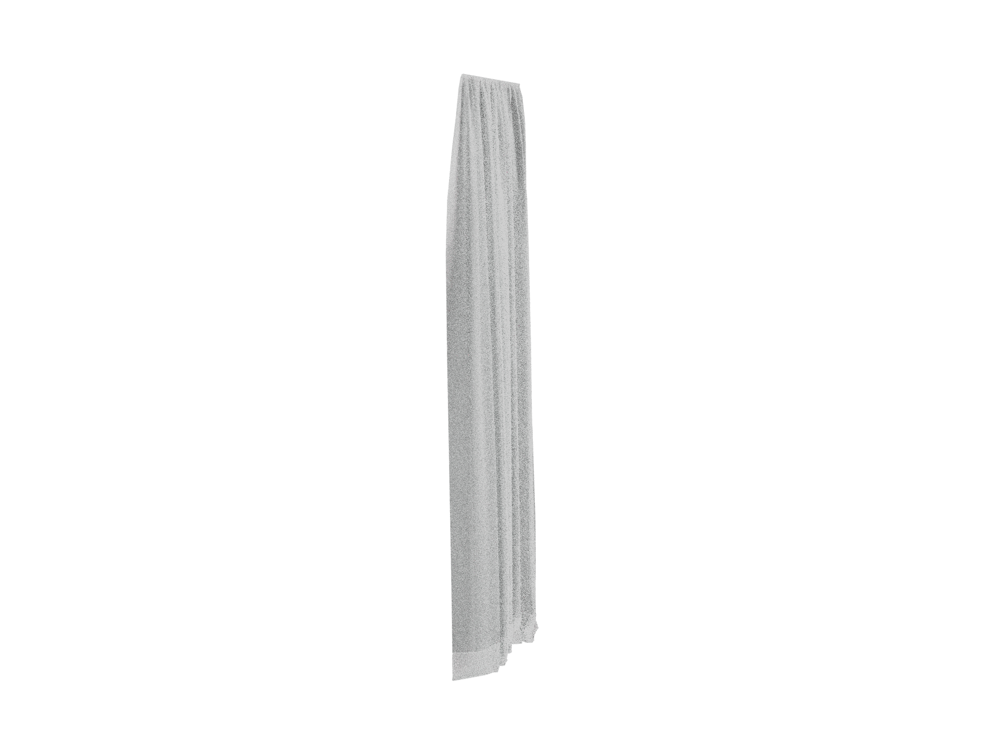
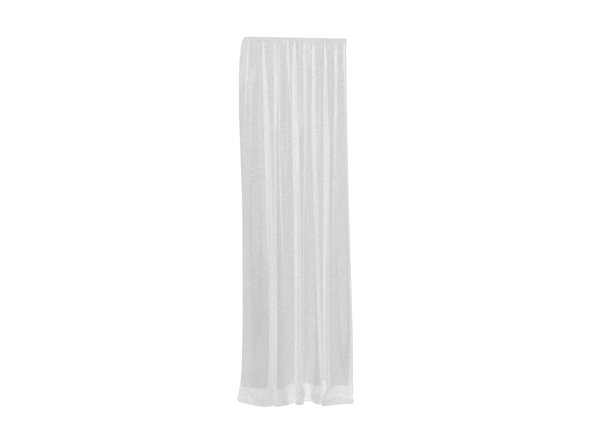
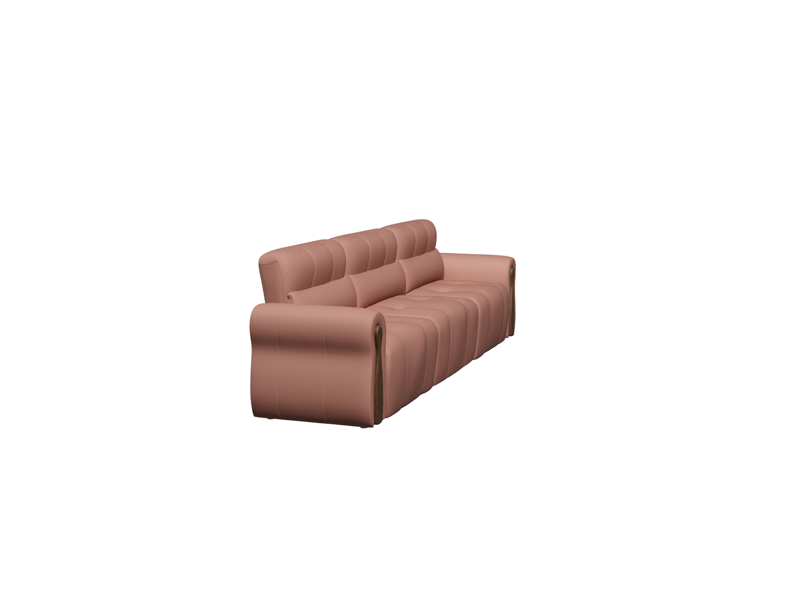
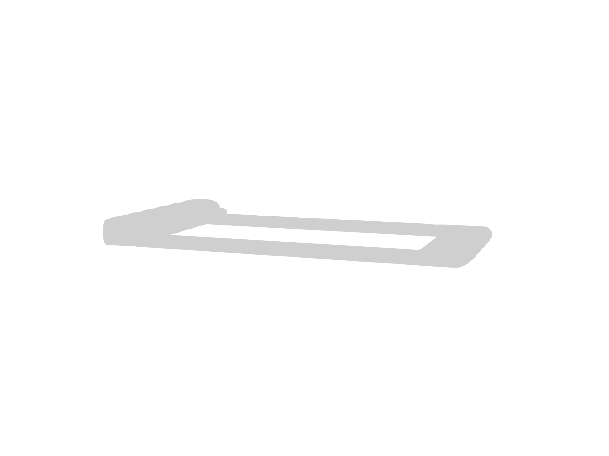
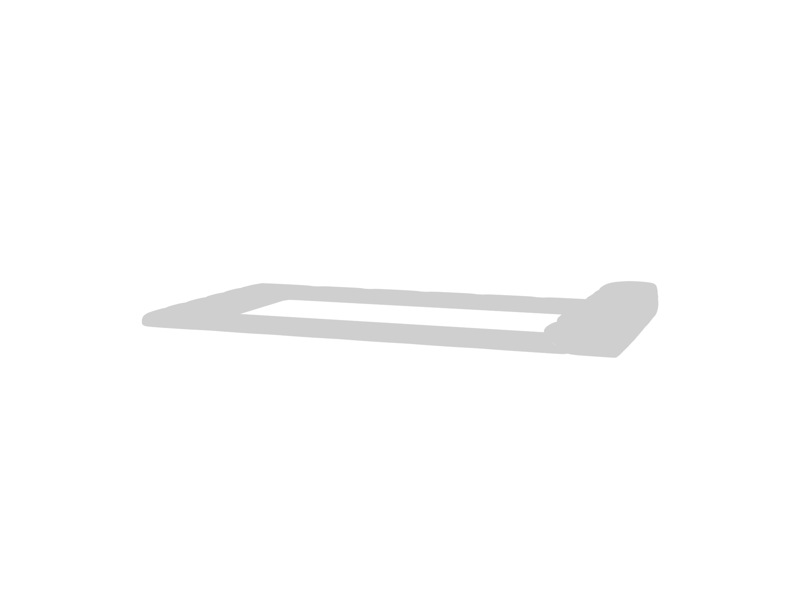

# UE5MaxVraySync · 最新实机测试结果

更新时间：**2026-10-13**。这是最新测试结果说明仓库，首页只展示本轮真实项目资产与当前算法检查；没有混入早期 13 球预览图、简模或纯色验证图。

**当前状态：完整预览包已打包；13 类复杂母材质仍为 PARTIAL，材质最终外观与完整同步十秒目标均未通过。** 原生数据检查、编译通过和 ZIP 校验分别记录，不替代最终视觉验收。

## 版本边界

- 已交付版本：`UE5MaxVraySync_FullPreview_20261013`。UE 5.5.4、3ds Max 2026、V-Ray GPU 7.40。
- 包中包含 V4 完整源几何恢复、V3 GPU 源正反面、最终 BaseColor 边界及现有复杂图重建；ORM、程序 UV、多套 UV 没有放弃。
- 本仓库另含**打包后**的线性纹理过滤实验：原生插值检查与完整窗帘 GPU 图已完成，但未改善整体 UE 对齐，尚未接入默认材质，**不在上面已交付 ZIP 中**。
- 最新包：518,977,572 字节、574 个校验文件。SHA256：`4c3fa6d901c5a44c6b6682b1ddc2cc5af1e7ed9cf0755f1b6b5d93cb5678efc1`。ZIP CRC 和全部文件哈希通过。完整插件 ZIP 已在本地交付，本测试仓库未上传 ZIP、原始网格或源贴图。

## 最新真实窗帘：UE / V-Ray 源数据对照

项目资产 `chuanglian_270x22x86`，自身 Sheers 材质，**8,996 面、两套 UV、一个源槽位**。没有使用 2,304 面 Nanite 回退模型。图片均为 **1920×1440 原图**，可点击打开。

| UE 源 BaseColor | 当前默认 V-Ray 源 BaseColor 数据图 |
|---|---|
|  |  |

同相机轮廓重合约 **99.58%**；内部 RGB 平均绝对差 **31.12 / 29.94 / 30.37**（0–255）。织纹和颜色差异仍明显，**未验收**。UE GBuffer 与 V-Ray 发光数据图的导出/色彩链尚未校准；轮廓重合不能证明材质或 UV 完全一致。

### 原材质灯光图：尚未完成照明校准

以下两张均使用真实原材质，但灯光/曝光尚未匹配，不能作为最终光学等价对照。

| UE 原材质 · 未校准照明 | 当前 V-Ray 原材质 |
|---|---|
|  |  |

最终 BaseColor 按 UE 属性边界限制为 0–1，六组原生范围检查最大误差约 **0.00000995**。仅单层材质应用，内部 Fuzzy/发光算式保留；Film 多层未纳入该规则。数据图临时关闭 PNG 显示转换，结束后恢复 ACEScg 和原 sRGB / ACES 1.0 SDR-video 输出设置。

## 最新过滤实验：有数学差异，实际对齐未改善

程序 UV 旧路径在 sRGB 编码值上过滤后再解码。采用 16 位线性 RGB 输入缓存，在过滤前解码源 texel；不烘焙 UV 或复杂材质，源图不修改，alpha 使用原独立通道。

- 原生周期边界黑白中点检查：旧顺序 **0.214038**；线性过滤 **0.499992**，理论线性值 0.5。
- 实际 4096×2343 窗帘色贴图首次转换约 **2.12 秒**。缓存按源内容指纹区分；方向、通道、alpha 隔离和缓存替换三项回归通过。
- 完整 8,996 面窗帘的 V-Ray GPU 实验图渲染 **46.63 秒**；读取 PNG16 成功，材质输入与输出设置恢复。
- 同一内部区域 RGB 差 **31.50 / 30.34 / 30.78**，默认图为 **31.12 / 29.94 / 30.37**。整体差异未改善，故不作为默认修复发布，也不宣称织纹修复。

下一步核对 UE 数据图导出编码、Fuzzy 使用的预遮罩法线，以及两端法线贴图 mip/过滤方式。

## 完整真实四槽沙发：几何与 Max 阶段性能

全项目资产 `Sofa/4/4`，**269,742 面、809,226 源顶点实例、四槽、三套 UV**，保留自身材质。未使用 3,090 面 Nanite 回退网格。

V4 从原始 GLB 缓冲恢复源法线、切线、副切线、符号、GPU 编码和第三套 UV，九个目标通道与独立参考逐字节一致，几何及其他通道保留检查通过。Max 冷几何提交至完成 **8.62 秒**，包含对应 Slate/视口工作；这不是 UE→Max 全流程时间。沙发没有已校准 UE 图，最终颜色、微表面、UV 外观仍未验收。

## GPU 源正反面与变换检查

真实项目床网格 **66,115 面**，非均匀 `(2,0.5,1.3)` 与镜像 `(-2,0.5,1.3)`。V3 使用源三角绕序方向替代单独依赖 V-Ray Ng。四项 1920×1440 相机/双面符号误差图检查通过，内部红/蓝/洋红误差像素为零。六项源位置、顶点法线变换和 Halo 算式检查通过。图中白色表示限定算式误差在容差内，**不是纯白最终材质图，也不是全光学验收**。

| 非均匀缩放 · 源面符号 | 镜像 · 源面符号 |
|---|---|
|  |  |

只使用空闲低编号通道或经完整保留核对的插件通道，未覆盖原始 UV。模块仅编译并测试 Max 2026。

## 全项目与 13 类状态

全 /Game 扫描 1,630 个资产、262 个 StaticMesh，测试不限于默认关卡。全部 13 个登记实例源图已重新读取；97 个实际源程序通过安装的 V-Ray OSL 编译。**编译不等于渲染通过**。各类完整效果如下：

| 母材质 | 最终光学状态 | 尚需完成 |
|---|---|---|
| Basic_StandardMaterial | PARTIAL | 最终颜色、粗糙度和真实 UV 对照 |
| Basic_GLB_Material | PARTIAL | Alpha/发光与最终 PBR 外观 |
| Basic_Anisotropy_Material | PARTIAL | 方向轴、镜像姿态与反射能量 |
| Basic_BubbleColor_Material | PARTIAL | 变体颜色和最终外观 |
| Basic_Dynamic_LampShade_Material | PARTIAL | Ring/Wire、布料透光与灯具光度 |
| Basic_Fabric_Material | PARTIAL | UE Cloth 与 V-Ray Sheen 的 BRDF |
| Basic_FilmGlass_Material | PARTIAL | 膜层顺序、覆盖率、透射与吸收 |
| Basic_Foliage_Material | PARTIAL | 角度散射和密度阴影 |
| Basic_FrostedGlass_Material | PARTIAL | 屏幕模糊与物理磨砂外观 |
| Basic_Sheers_Material | PARTIAL | 织纹、Fuzzy 法线、透射散射与阴影 |
| Basic_SimpleGlass_Material | PARTIAL | 吸收厚度、反射和透射 |
| Basic_TilingWithFrames_Material | PARTIAL | 真实资产平铺、旋转与接缝 |
| Basic_TilingWithMural_Material | PARTIAL | 图案尺度、旋转与最终叠层效果 |

源 Opacity/Density 的中间数学式已有原生数值检查，但未接入 V-Ray 每灯实际遮挡距离/可见性，密度阴影仍未实现完整对应。MHL 历史紫色检查不作为本次通过证据；全部用户对象的 GPU 外观仍未认证。旧 .max 的嵌入式 OSL 不会因复制新源码自动更新。

## 速度说明

| 记录 | 秒 | 范围 |
|---|---:|---|
| 最新窗帘有缓存提交 | 4.36 | Max 阶段 |
| 窗帘冷几何提交 | 3.42 | Max 阶段，较早同日记录 |
| 完整四槽沙发冷提交 | 8.62 | Max 阶段 |
| UE 源准备已有基线 | 43.95 | UE 阶段，尚未证明完成优化 |
| 最新窗帘线性过滤图 | 46.63 | V-Ray 渲染时间，与同步分开 |

**完整点击发送至 Max 完成的十秒目标未通过；没有“全流程两秒”结论。** 当前用户 UE 编辑器响应异常，对照图由独立测试进程采集；未保存或修改用户关卡。

## 证据与安装

- [13 类状态记录](reports/13_master_status.json)
- [窗帘源数据测量](reports/curtain_source_pair.json)
- [过滤数学检查](reports/linear_filter_native_gate.json) / [GPU 实测记录](reports/linear_filter_gpu_render.json)
- [源正反面检查](reports/source_facing_gpu_acceptance.json) / [源变换检查](reports/source_transform_acceptance.json)
- [沙发 V4 数据保留](reports/sofa_v4_source_transfer.json)
- [当前 ZIP 校验](reports/delivered_zip_verification.json) / [插件验收范围](reports/delivered_package_verification.json)
- [完整预览包安装说明](docs/INSTALL_20261013.md)
- `MANIFEST.json` 提供本仓库证据文件 SHA256；图片保持原始字节。本仓库没有上传测试资产网格或贴图。
